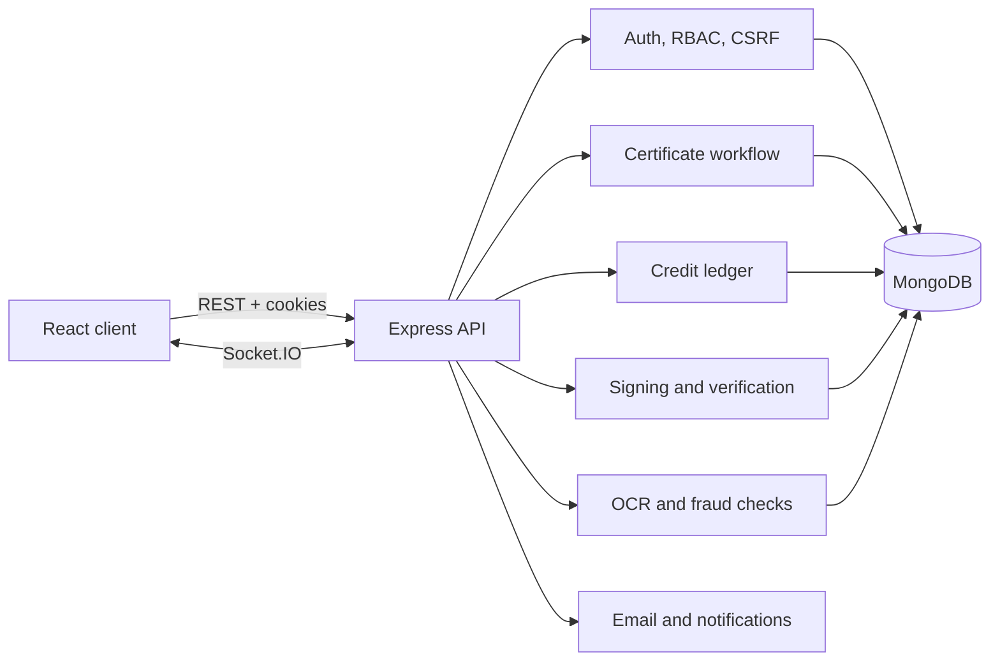
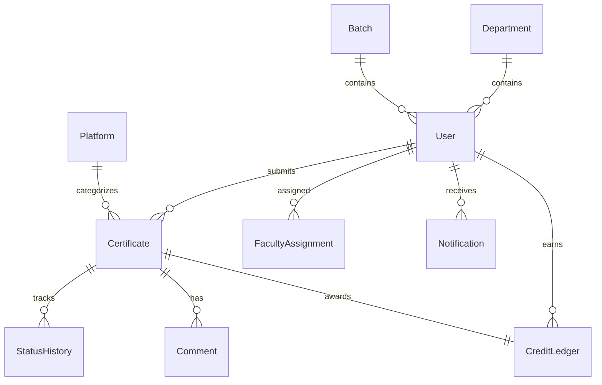

# CertTrack

CertTrack is a full-stack certification and course tracker for educational
institutions. Students submit proof of completed courses, faculty verify the
submissions, credits are awarded through an append-only ledger, and approved
credentials can be verified publicly with a signed payload and QR code.

## Features

- Student, faculty, HOD and admin roles with scoped access.
- Certificate workflow: draft, submitted, under review, needs changes, approved,
  rejected, with audit history and optimistic version checks.
- Append-only credit ledger, per-semester progress and credit rules.
- Public verification page plus Ed25519-signed credentials and a JWKS endpoint.
- Proof-document uploads with type/size validation and authenticated access.
- OCR-assisted field suggestions from PDF and image proofs.
- Duplicate and trust scoring, external-link checks, CSV import/export.
- Email verification, password reset, optional TOTP two-factor authentication,
  Google sign-in, session management and account lockout.
- Notifications over REST and Socket.IO, analytics, leaderboard and reports.
- Swagger/OpenAPI documentation for the API.

## Architecture





## Tech stack

| Layer    | Tools                                                               |
| -------- | ------------------------------------------------------------------- |
| Client   | React 19, Vite, React Router, TanStack Query, Zustand, Tailwind CSS |
| Forms/UI | React Hook Form, Zod, Recharts, Framer Motion, lucide-react         |
| Server   | Node.js, Express, Mongoose, Zod, JWT, Socket.IO, Pino               |
| Security | Helmet, CORS allow-list, rate limiting, CSRF, bcrypt, TOTP, Ed25519 |
| Extras   | Tesseract.js, pdf-parse, qrcode, pdfkit, Swagger, Nodemailer, xlsx  |

## Repository layout

```
.
├── client/                 React single-page application
│   ├── src/components      Layout and reusable UI components
│   ├── src/pages           Route-level pages
│   ├── src/services        API wrappers
│   └── src/store           Zustand auth store
├── server/                 Express API
│   ├── src/config          Environment, database, logger
│   ├── src/controllers     HTTP handlers
│   ├── src/middleware      Auth, validation, uploads, errors
│   ├── src/models          Mongoose models
│   ├── src/routes          API routes
│   ├── src/services        Business logic
│   ├── src/utils           Shared helpers and seed script
│   └── tests               node:test unit and smoke tests
└── scripts/dev.mjs         Runs client and server together
```

## Getting started

### Prerequisites

- Node.js 20 or newer (see `.nvmrc`)
- npm 10 or newer
- MongoDB 6 or newer, local or hosted

### Install

```bash
npm run setup
```

This installs dependencies in `server/` and `client/`.

### Configure

```bash
cp server/.env.example server/.env
cp client/.env.example client/.env
```

Set `MONGODB_URI` and replace both JWT secrets. In production, use 32+ character
secrets, set `COOKIE_SECURE=true`, and configure `CORS_ORIGINS` explicitly.

Without SMTP configured, the server writes outgoing email content to the log in
development. Verification and password-reset links can be copied from there.

### Seed demo data

```bash
npm run seed
```

Seeding refuses to run when certificates already exist. Use `npm run seed:reset`
to drop the database first. The seed prints development-only credentials for the
admin, HOD, faculty and student accounts it creates.

### Run

```bash
npm run dev
```

- Client: <http://localhost:5173>
- API: <http://localhost:5000>
- Swagger UI: <http://localhost:5000/api-docs>
- Health: <http://localhost:5000/health>
- JWKS: <http://localhost:5000/.well-known/jwks.json>

## Scripts

Run these from the repository root:

| Command                | Purpose                                |
| ---------------------- | -------------------------------------- |
| `npm run setup`        | Install server and client dependencies |
| `npm run dev`          | Start API and client with one command  |
| `npm run build`        | Production build of the client         |
| `npm run lint`         | ESLint (server) and Oxlint (client)    |
| `npm test`             | Server unit and smoke tests            |
| `npm run seed`         | Seed demo data into an empty database  |
| `npm run seed:reset`   | Drop the database and reseed           |
| `npm run format`       | Format supported files with Prettier   |
| `npm run format:check` | Check formatting without writing       |

## Roles

| Capability                       | Student | Faculty  | HOD             | Admin |
| -------------------------------- | ------- | -------- | --------------- | ----- |
| Submit and edit own certificates | Yes     | No       | No              | Yes   |
| Review assigned certificates     | No      | Yes      | Department-wide | Yes   |
| Approve or request changes       | No      | Yes      | Yes             | Yes   |
| Revoke an approved certificate   | No      | No       | Yes             | Yes   |
| Manage users, settings, imports  | No      | No       | No              | Yes   |
| View audit logs                  | Own     | Assigned | Department      | All   |

## API overview

All responses use an envelope of `{ success, data, error, meta }`. The base path
is `/api/v1`. Business errors include a stable `code` and a human-readable
`message`.

| Method | Path                           | Access               | Purpose                          |
| ------ | ------------------------------ | -------------------- | -------------------------------- |
| POST   | `/auth/register`               | Public               | Create a student account         |
| POST   | `/auth/login`                  | Public               | Sign in, optional 2FA code       |
| POST   | `/auth/refresh`                | Cookie + CSRF        | Rotate the refresh token         |
| GET    | `/auth/verify-email/:token`    | Public               | Verify an email address          |
| POST   | `/auth/forgot-password`        | Public               | Request a reset link             |
| POST   | `/auth/reset-password/:token`  | Public               | Set a new password               |
| GET    | `/certificates`                | Authenticated        | Paginated, filtered list         |
| POST   | `/certificates`                | Student              | Create a draft                   |
| PATCH  | `/certificates/:id`            | Owner or admin       | Edit an editable certificate     |
| POST   | `/certificates/:id/proof`      | Owner                | Upload or replace proof          |
| GET    | `/certificates/:id/proof`      | Scoped authenticated | Stream the proof document        |
| POST   | `/certificates/:id/submit`     | Owner                | Submit for review                |
| POST   | `/certificates/:id/transition` | Verifier or override | Approve, reject or request work  |
| GET    | `/verify/:verificationId`      | Public               | Public credential verification   |
| GET    | `/analytics/...`               | Scoped by role       | Student, faculty and department  |
| GET    | `/admin/...`                   | Admin or HOD         | User and organisation management |

## Security notes

- Access tokens live in memory; refresh tokens are httpOnly cookies with rotation.
- Mutating cookie-authenticated requests require a CSRF token.
- Uploaded proof files are served through an authorization-checked endpoint, not a
  public static directory.
- CSV exports neutralize spreadsheet formula injection.
- Login attempts are rate-limited and accounts lock after repeated failures.
- Two-factor authentication can be enabled per account with any TOTP app.
- The server refuses to start in production with missing or weak auth secrets, an
  insecure cookie setting, or no database URI.

See [SECURITY.md](SECURITY.md) for reporting vulnerabilities.

## Testing

Server tests use the built-in `node:test` runner and do not require MongoDB:

```bash
npm test
```

CI also runs linting, the client production build and server tests. See
`.github/workflows/ci.yml`.

## Deployment

1. Build the client with `VITE_API_URL` pointing at the public API origin.
2. Serve `client/dist` from a static host and rewrite unknown paths to
   `index.html` for client-side routing.
3. Run the API with `npm start --prefix server` behind HTTPS.
4. Point `CLIENT_URL`, `CORS_ORIGINS` and `GOOGLE_CALLBACK_URL` at the deployed
   origins.
5. Persist `server/uploads/` and `server/.keys/` on durable storage if proofs and
   signatures must survive redeploys.

## Limitations

- External certificate links are checked best-effort and are not a guarantee of
  authenticity.
- OCR quality depends on the uploaded document.
- AI features require `ANTHROPIC_API_KEY` and are optional.
- Scheduled reminder jobs run in-process; a production deployment with multiple
  API instances should use a shared job runner.

## Contributing

See [CONTRIBUTING.md](CONTRIBUTING.md). Please also read the
[code of conduct](CODE_OF_CONDUCT.md).

## License

MIT — see [LICENSE](LICENSE).
